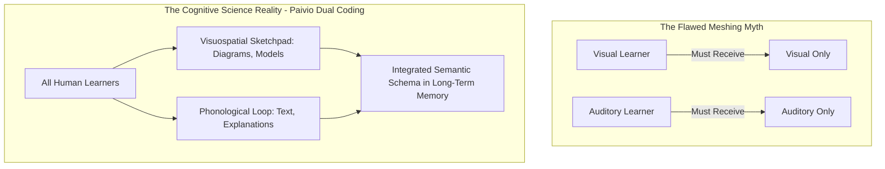

# Neuromyths in Education: Empirical Refutations, Cognitive Realities, and Evidence-Based Substitutes

> **The Epistemic Defense Axiom**:  
> Bad cognitive science is worse than no science at all. Neuromyths waste millions in educational budgets, legitimize low-expectation tracking, and misdiagnose instructional failure as biological incompatibility.

---

## 0. Learning Contract & Target Competencies

By engaging with this refutational foundation, you will develop the ability to:
1. **Identify** and systematically **dissect** the 4 major educational neuromyths: Learning Styles (VAK), Left-Brain vs. Right-Brain dominance, the 10% Brain Myth, and Rigid Critical Periods.
2. **Explain** the **Meshing Hypothesis** and articulate why decades of factorial RCTs consistently fail to produce the crossover interaction required to validate learning styles.
3. **Replace** intuitive neuromyths with verified cognitive science constructs: **Dual Coding Theory**, **Corpus Callosum Interhemispheric Transfer**, and **Experience-Dependent Neuroplasticity**.
4. **Defend** educational systems and classroom policy against commercial neuro-snake-oil vendors.

---

## 1. The Intuitive Dilemma: The "Visual Learner" Excuse

Consider this authentic classroom conference:
> *A 10th-grade geometry teacher, Sarah, meets with the parents of Leo. Leo scored 42% on the deductive coordinate geometry proof test. His mother presents a private diagnostic report from an educational coaching center:  
> "Leo is a 94th-percentile Kinesthetic-Visual learner. Sarah's class is predominantly verbal and symbolic. His brain simply cannot encode proofs unless they are presented as physical tactile manipulatives or color-coded video clips."*

Sarah feels trapped: Is Leo genuinely biologically mismatched with formal deductive reasoning, or does this diagnosis construct an artificial barrier to mathematical agency?

### The Prediction Challenge
*Before reading Section 2, commit to one of the following decisions:*
- **Choice A**: Differentiate instruction by excusing Leo from formal symbolic algebraic proofs and assessing him purely through physical clay 3D model construction.
- **Choice B**: Retain the symbolic mathematical target, but pair it with spatial-visual coordinate representations (Dual Coding) while explicitly explaining to Leo that human working memory processes both verbal and visual channels simultaneously regardless of self-reported preference.
- **Choice C**: Administer a VAK diagnostic inventory to the entire class and group students into visual, auditory, and kinesthetic cohorts for the remainder of the semester.

---

## 2. Forensic Dissection of the 4 Major Neuromyths

### Neuromyth 1: The Learning Styles (VAK) / Meshing Fallacy
* **The Claim**: Instruction is most effective when matched to a learner's self-reported perceptual modality (Visual, Auditory, Kinesthetic).
* **The Empirical Falsification (Pashler et al., 2008; Rogowsky et al., 2015, 2020)**:
  * To prove the "Meshing Hypothesis," an experiment must demonstrate a statistically significant **crossover interaction**: Visual learners must learn significantly better from visual materials than auditory materials, *AND* auditory learners must learn significantly better from auditory materials than visual materials.
  * In rigorous pre-registered RCTs with matched vs. mismatched conditions, **zero crossover interaction has ever been found** ($d = 0.02, p = .78$). All students—regardless of self-reported preference—learn spatial concepts better with diagrams and language concepts better with text/speech.
* **The Mechanism**: Information is stored semantically in abstract conceptual networks, not as raw sensory pixel/audio files. Meaning trumps sensory modality.



### Neuromyth 2: "Left-Brain vs. Right-Brain" Learners
* **The Claim**: Logical, analytical students are "left-brained"; creative, holistic students are "right-brained."
* **The Empirical Falsification (Nielsen et al., 2013, $N=1,011$)**:
  * Functional connectome fMRI analysis across 1,011 individuals analyzing 7,266 brain regions found **no evidence of individuals having stronger left- or right-sided brain networks**.
* **The Mechanism**: While specific brain functions exhibit lateralization (e.g., Broca's area for speech syntax in the left hemisphere for 95% of right-handers), any complex cognitive task—solving a calculus problem, writing poetry, reading music—requires continuous, high-speed interhemispheric communication across the **200+ million axonal fibers of the corpus callosum**.

### Neuromyth 3: "We Only Use 10% of Our Brain"
* **The Claim**: 90% of our neural potential is dormant and can be unlocked with proprietary brain-training software.
* **The Empirical Falsification**: Evolutionarily, the brain constitutes 2% of body mass but consumes **20% of resting metabolic energy (glucose and oxygen)**. Natural selection would aggressively eliminate non-functional brain tissue. PET, fMRI, and single-unit recordings show continuous distributed metabolic activation throughout the brain even during sleep.

### Neuromyth 4: Rigid "Critical Periods" Preclude Adult Learning
* **The Claim**: If a child does not learn a language, instrument, or mathematics by age 3 (or puberty), the brain permanently closes its developmental window.
* **The Reality (Sensitive vs. Critical Periods)**:
  * True *critical periods* exist for basic sensory calibration (e.g. monocular visual deprivation in amblyopia; Hubel & Wiesel).
  * Complex cognitive, mathematical, and conceptual acquisitions operate under **sensitive periods**: plasticity remains active throughout adulthood via experience-dependent myelination, neurogenesis in the subgranular zone of the dentate gyrus, and synaptic restructuring.

---

## 3. Worked Clinical Example: Refuting a Commercial Neuromyth in a School District

### Case: School District Purchasing a \$150,000 "Brain-Gym / VAK Assessment" Suite
A district curriculum director is about to sign a contract for a proprietary software suite that sorts K–8 students into visual, auditory, and kinesthetic tracks and prescribes daily contralateral cross-crawl exercises.

* **Expert Pedagogical Intervention**:
  1. **Acknowledge Intuition**: *"Teachers love this tool because they see that children are diverse and struggle with pure lecturing."*
  2. **Introduce the Empirical Evidentiary Standard**: Present the **EEF (Education Endowment Foundation)** toolkit rating: *Learning Styles: 0 months progress, £££ cost, evidence security 0/5.*
  3. **Reallocate to High-Impact Cognitive Architecture**: Divert the $150,000 budget into:
     - Formative assessment and hinge-question calibration ($+7\text{ months progress}, d = 0.41$).
     - Concrete-to-Representational (CPA) math bridge resources ($d = 0.54$).
     - Dual-coding visual assets for all science classrooms ($d = 0.57$).

---

## 4. Non-Example / Pathological Case: The Self-Fulfilling Identity Trap

1. **Teacher Action**: A middle-school teacher labels Student M as a "Kinesthetic Learner" after an online quiz.
2. **Pathological Sequence**:
   - When Student M encounters abstract fraction division ($\frac{2}{3} \div \frac{4}{5}$), she says: *"I can't do this, I'm kinesthetic. I need to move around or hold blocks."*
   - The teacher stops challenging Student M with formal mathematical abstraction, providing only wooden blocks.
   - Student M never transitions from the *Concrete* to the *Abstract* stage (violating CPA progression).
3. **Harm**: Neuromyths transform a temporary instructional challenge into a fixed, biological cognitive identity.

---

## 5. Misconception Diagnostics & Refutation Table

| Neuromyth Belief | What the Teacher Observes | What Cognitive Science Actually Explains |
| :--- | :--- | :--- |
| **"He struggles because he's a visual learner being taught verbally."** | Student loses focus during a long verbal lecture. | Working memory phonological loop is overloaded by excessive auditory speech without visual anchoring. *All* students in the room are suffering cognitive overload, not just "visual learners." |
| **"Girls are right-brained and creative; boys are left-brained and analytical."** | Unequal participation in physics vs. literature. | Cultural conditioning, stereotype threat, and prior instructional exposure, with zero structural hemispheric dichotomy. |
| **"If an intervention cites neuroimaging (fMRI), it must be effective."** | Neuropackaging bias: adding irrelevant fMRI brain images makes bad pedagogical claims 40% more persuasive to non-experts (Weisberg et al., 2008). | fMRI is descriptive (showing blood-oxygen level dependent [BOLD] signal correlation), not instructional prescriptive. |

---

## 6. Formative Hinge Question & Distractor Analysis

> **Scenario**: A biology teacher wants to teach the mechanism of cellular mitosis (prophase, metaphase, anaphase, telophase). Based on cognitive science rather than neuromyths, what is the most effective design?

* **Option A**: Administer a VAK survey, then divide the class into three stations: Station 1 watches animations (visuals), Station 2 listens to podcasts (auditories), and Station 3 acts out mitosis with their bodies (kinesthetics).
* **Option B**: Present a synchronized diagram showing chromosome alignment while simultaneously explaining the spindle fiber mechanics verbally (Dual Coding), followed by having all students sketch and label the stages from memory (Retrieval Practice).
* **Option C**: Teach the analytical terminology only to left-brained students and let right-brained students draw creative metaphorical art about cell birth.
* **Option D**: Avoid direct instruction entirely because adolescents have passed the critical period for cellular concept acquisition.

### Diagnostic Distractor Analysis:
* **Option A**: Diagnoses the *VAK Neuromyth*. Dilutes instructional fidelity, fragments teacher attention, and deprives students of integrated multimodal encoding ($d = 0.02$).
* **Option B (CORRECT)**: Employs Dual Coding (simultaneous visual and verbal integration) and active retrieval testing ($d = 0.74$), which benefits 100% of human nervous systems.
* **Option C**: Diagnoses the *Hemispheric Dichotomy Neuromyth*. Creates dangerous academic tracking based on non-existent biological boundaries.
* **Option D**: Diagnoses the *Critical Period Fallacy*. Confuses sensory maturation with lifelong conceptual plasticity.

---

## 7. Actionable School Policy: The "Neuro-Sanity" Audit Checklist

```yaml
policy: SCHOOL-NEUROMYTH-PURGE
checklist:
  1_purge_vak_surveys:
    action: "Cease administering VAK or sensory learning styles diagnostic surveys."
    replacement: "Assess prior domain knowledge, reading fluency, and specific misconceptions."
  2_enforce_dual_coding:
    action: "Require all core instructional units to combine schematic visual models with explicit verbal explanations."
    standard: "Both representations must explain the same conceptual mechanism simultaneously."
  3_ban_hemispheric_labeling:
    action: "Prohibit classifying students or academic subjects as 'left-brain' or 'right-brain'."
    standard: "Treat analytical rigor and creative synthesis as integrated across all disciplines."
  4_audit_commercial_vendors:
    filter: "Require vendors claiming 'brain-based' learning to produce peer-reviewed, preregistered factorial RCTs demonstrating crossover interaction."
```

---

## 8. Empirical Evidence & Effect Sizes

| Empirical Investigation | Methodology / Sample | Primary Metric / Effect Size | Core Conclusion |
| :--- | :--- | :--- | :--- |
| **Pashler, McDaniel, Rohrer, & Bjork (2008)** | Commissioned Review for *Psychological Science in the Public Interest* | Landmark Policy Audit | *"Virtually no evidence exists justifying the incorporation of learning-styles assessments into general educational practice."* |
| **Rogowsky, Calhoun, & Tallal (2015, 2020)** | Factorial Randomized Controlled Trial ($N=121$) | $F(1, 117) = 0.08, p = .78, \eta^2_p = .001$ | Statistically zero crossover interaction between learning style preference and instructional modality. |
| **Dekker, Lee, Howard-Jones, & Jolles (2012)** | Cross-national survey of 242 educators | $93\%$ endorse VAK myth | Neuromyths are pervasive even among experienced, well-intentioned teachers. |
| **Weisberg, Keil, Goodstein, Rawson, & Gray (2008)** | *Journal of Cognitive Neuroscience* ($N=180$) | $d = 0.72$ | Seductive Allure of Neuroscience: Inept explanations become significantly more credible when accompanied by spurious neuroscientific jargon. |

---

## 9. Non-Example Set: Popular Self-Help Claims About Learning

Neuromyths also travel inside good books. This set takes five claims from one popular self-teaching book and checks each against a source opened for this section. The aim is to train the audit move, not to dismiss the book.

**Idea lineage:** *The Craft of Self-Teaching* (自学是门手艺) by Li Xiaolai ([github.com/xiaolai/the-craft-of-selfteaching](https://github.com/xiaolai/the-craft-of-selfteaching), CC BY-NC-ND 3.0). The book's claims are paraphrased; no passage is translated or copied. Several of its other ideas look consistent with mainstream learning research on an authored reading (learners building and correcting their own summaries, decomposing hard tasks, targeting practice at personal weak spots, explaining to others); they are not assessed here. The five claims below are the parts at risk of becoming myths when repeated without their limits.

**Status:** authored extension, `unreviewed`. Each verdict is limited to the scope recorded in the linked source record (abstracts only in this run). Numerical results stay in those records.

### Prediction Challenge
*Before reading the table, mark each claim as "supported", "contested" or "not supported", and write what evidence would change your mind.*

| Claim as it circulates | How the book uses it (paraphrase) | What the opened source reports | Limit of that source | Evidence-aligned substitute |
| :--- | :--- | :--- | :--- | :--- |
| **"Mirror neurons explain how we learn from watching others."** | Explains imitation and why watching skilled, enthusiastic people motivates learners. | Hickok (2009) argues that no monkey data directly test the mirror-neuron theory of action understanding and that human evidence makes a strong case against it ([record](../../60-evidence/sources/evidence-hickok-2009-mirror-neurons.md)). | Addresses action understanding. It does not deny that people learn by observing others; the broader social and emotional extensions were not checked here. | Keep modelling, worked demonstrations and expert think-aloud; justify them by what learners can do afterwards, not by a neural mechanism. |
| **"Memory is a general skill you can train like a muscle."** | Treats memory as a craft that deliberate practice can strengthen at any time, and poor recall as a major obstacle to self-teaching. | Melby-Lervåg & Hulme (2013): working-memory training gave short-term, specific gains, verbal gains faded at follow-up, and there was no convincing generalization to other abilities, attention, decoding or arithmetic ([record](../../60-evidence/sources/evidence-melby-lervag-2013-working-memory-training.md)). | Covers working-memory training programs only; mnemonic strategies and domain-knowledge growth were not tested. | Build the specific knowledge the task needs with retrieval and spaced revisits; plan for forgetting instead of treating it as a character flaw. |
| **"Talent is irrelevant; practice is everything."** | Mainly argues that failing on the first attempt says nothing about talent or IQ, which is a useful reframing. The myth risk is the general version. | Macnamara, Hambrick & Oswald (2014): deliberate practice explained a minority of performance variance in every domain studied, least in education and professions ([record](../../60-evidence/sources/evidence-macnamara-2014-deliberate-practice.md)). | Shows that measured practice leaves most variance unexplained; it does not identify that remainder as talent. | Attribute early struggle to strategy, time and feedback; do not promise equal outcomes from equal practice. |
| **"Learning to program trains general thinking for life."** | Presents programming as practice for coping with the out-of-order knowledge of work and life, and the habits it builds, such as decomposition, as useful everywhere. | Scherer, Siddiq & Sánchez Viveros (2019) report near and some far transfer to measured skills (creative thinking, mathematics, metacognition, then spatial skills and reasoning); school achievement and literacy benefited least, and effects were larger with untreated controls ([record](../../60-evidence/sources/evidence-scherer-2019-programming-transfer.md)). Sala & Gobet (2017) found that, for chess, music and working-memory training, effects shrank as design quality rose, and concluded that far transfer rarely occurs ([record](../../60-evidence/sources/evidence-sala-2017-far-transfer.md)). | Contested rather than refuted: transfer to specific cognitive measures has meta-analytic support with design caveats. "Life thinking" was not an outcome in either source. | Teach transfer explicitly: name the principle, practise it in a second context, and assess it there. |
| **"Reread until it sticks."** | Uses several reading passes as the main repeat loop; its map-first look at the table of contents is a separate, reasonable move. | Dunlosky et al. (2013) rate rereading as low utility and practice testing and distributed practice as high utility ([record](../../60-evidence/sources/evidence-dunlosky-2013-learning-techniques.md)). | Utility ratings are the authors' qualitative judgments; the per-technique reviews were not read in this run. | Keep a first skim for the map; make later passes closed-book recall with feedback, spaced over days. |

### Hinge Question
> A learner says: "This book says memory is a skill, so I'm doing 20 minutes of a memory-game app every day before studying Spanish vocabulary." What is the most defensible response?

* **A.** Keep the app; general memory training will make the vocabulary easier.
* **B.** Replace the app time with spaced, closed-book recall of the Spanish words themselves, and check retention a week later. **(Target)**
* **C.** Stop studying vocabulary; memory capacity is fixed, so effort will not help.
* **D.** Reread the word list more times, since familiarity shows it is working.

**Distractor map.** A expects far transfer from working-memory training; probe what the trained task and the target task share, then show the scope of the [record](../../60-evidence/sources/evidence-melby-lervag-2013-working-memory-training.md). C over-corrects from "training does not generalize" to "learning is impossible"; contrast general capacity with specific knowledge. D treats familiarity as retention; run a closed-book recall check. A choice alone does not diagnose the learner's reasoning; ask why before routing.
