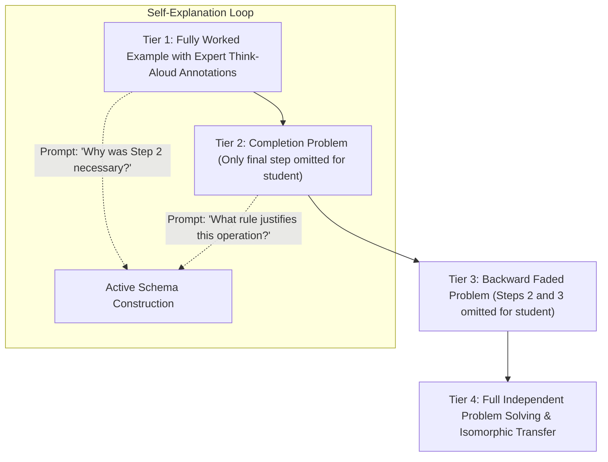

# The Worked-Example Fading Protocol: Cognitive Scaffolding, Completion Problems, and Self-Explanation Prompts

> **The Cognitive Load Scaffolding Axiom**:  
> Asking a novice to solve an unassisted problem from scratch forces them to rely on **means-ends analysis**—an exhaustive, random search through working memory that generates high extraneous load and zero schema acquisition. Studying a step-by-step worked example frees 100% of working memory capacity to encode the underlying structural schema.

---

## 0. Learning Contract & Target Competencies

By engaging with this clinical intervention, you will develop the ability to:
1. **Design** a 4-tier **Backward Fading Sequence** (Fully Worked $\rightarrow$ Final-Step Completion $\rightarrow$ Two-Step Faded $\rightarrow$ Full Independent Transfer).
2. **Embed** structured **Self-Explanation Prompts** (Chi, 1994) that prevent passive skimming and force learners to articulate *why* a mathematical or scientific step was taken.
3. **Navigate** the **Expertise Reversal Effect** (Kalyuga et al., 2003): Knowing exactly when to fade out worked examples to prevent cognitive redundancy for advancing learners.
4. **Transform** frustrating, high-failure problem sets into progressive competence-building sequences.

---

## 1. The Intuitive Dilemma: The Homework Frustration Spiral

Consider this widespread parent-teacher conference scenario:
> *Mr. Davis teaches 7th-grade algebra. In class, he solves 2 problems on the board, then assigns 25 multi-step equations for homework: $3(2x - 4) + 5 = 29$.  
> That evening, 12-year-old Jason sits at the kitchen table. He stares at the sheet for 45 minutes, bursts into tears, and says: "I don't know what to do with the parentheses! I hate math!"  
> His parents try to help, but use a different method. Jason arrives at school frustrated, incomplete, and anxious.*

Mr. Davis thinks: *"Students these days lack grit. If they just practiced more, they would get it."*

### The Prediction Challenge
*Before reading Section 2, commit to one of the following instructional diagnoses:*
- **Diagnosis A**: Jason lacks academic grit and needs stricter homework penalties.
- **Diagnosis B**: Mr. Davis committed the **Worked Example Deficit Error**. Assigning 25 unguided problems to a novice induces cognitive overload. Replacing 15 of those problems with paired **Worked Examples and Completion Tasks** would double learning while cutting homework time in half.
- **Diagnosis C**: Algebra should not be taught until age 16.

---

## 2. The Backward Fading Architecture



### 2.1. Why Backward Fading Outperforms Forward Fading
Alexander Renkl and Robert Atkinson (2002, 2003) demonstrated that **Backward Fading** is empirically superior to Forward Fading:
* In forward fading, the student must execute Step 1, which has the highest ambiguity and strategic uncertainty. If they stumble on Step 1, the entire subsequent problem collapses.
* In **backward fading**, the expert provides the setup and intermediate transitions. The student is responsible only for the final closure step.
* This allows the student to experience **immediate enactive mastery** and closure without getting lost in initial formulation mechanics. In the next problem, the scaffold recedes backward one step further.

---

## 3. Worked Clinical Example: A 4-Tier Faded Algebra Progression

### Tier 1: Fully Worked Example with Self-Explanation Prompt
$$\text{Solve for } x: \quad 4(x + 3) - 7 = 21$$

```text
[Step 1: Distribute the 4 across parentheses]
4 * x + 4 * 3 - 7 = 21
4x + 12 - 7 = 21
[Expert Think-Aloud]: "Before I can isolate x, I must unpack the terms trapped inside parentheses."

[Step 2: Combine constant terms on the left side]
4x + 5 = 21
[Expert Think-Aloud]: "12 minus 7 is 5. Simplifying constants reduces the equation to a standard two-step form."

[Step 3: Subtract 5 from both sides to isolate the variable term]
4x = 16
[Expert Think-Aloud]: "Inverse operation of +5 is -5."

[Step 4: Divide both sides by 4]
x = 4
[Expert Think-Aloud]: "4x means 4 multiplied by x; dividing by 4 isolates 1x."

>>> MANDATORY SELF-EXPLANATION PROMPT <<<
"Why was it essential to combine 12 - 7 in Step 2 before trying to divide by 4?"
[Student writes 1-sentence justification before turning page.]
```

### Tier 2: Completion Problem (Step 4 Omitted)
$$\text{Solve for } x: \quad 5(x + 2) - 8 = 22$$
* *Step 1 (Provided)*: $5x + 10 - 8 = 22$
* *Step 2 (Provided)*: $5x + 2 = 22$
* *Step 3 (Provided)*: $5x = 20$
* *Step 4 (STUDENT COMPLETES)*: $\underline{\hspace{4cm}}$

### Tier 3: Backward Faded Problem (Steps 3 & 4 Omitted)
$$\text{Solve for } x: \quad 3(x + 4) - 5 = 19$$
* *Step 1 (Provided)*: $3x + 12 - 5 = 19$
* *Step 2 (Provided)*: $3x + 7 = 19$
* *Step 3 (STUDENT COMPLETES)*: $\underline{\hspace{4cm}}$
* *Step 4 (STUDENT COMPLETES)*: $\underline{\hspace{4cm}}$

### Tier 4: Independent Problem
$$\text{Solve for } x: \quad 2(x + 5) - 3 = 23$$
* *Full independent execution by student.*

---

## 4. Non-Example / Pathological Case: "Example Without Think-Aloud"

1. **Teacher Action**: The teacher prints 5 worked problems on a worksheet, but includes only the bare algebraic steps without annotations, commentary, or self-explanation prompts.
2. **Cognitive Analysis**:
   * Novice students **skim the lines passively**, experiencing the illusion of understanding (*"Looks simple"*).
   * They do not attend to the *subgoals* or underlying strategic decisions.
   * Without **Self-Explanation Prompts** (e.g. *"Why did the minus sign become plus?"*), worked examples degenerate into passive decorative text ($d$ drops from $0.65$ to $0.10$).

---

## 5. Misconception Diagnostics & Refutation Table

| Misconception | Classroom Phenomenon | Cognitive Science Reality |
| :--- | :--- | :--- |
| **"Giving students worked examples is cheating; they should struggle."** | Refusing to show complete solutions before homework. | The **Worked Example Effect** (Sweller, 1988) is one of the most robust findings in cognitive psychology ($d = 0.60 - 0.90$). Novices cannot struggle productively on procedural tasks because they lack the requisite schemas. |
| **"Worked examples should be given for every problem all year long."** | Providing full solutions to advanced students. | **Expertise Reversal Effect** (Kalyuga et al., 2003): Once a student acquires domain schemas, worked examples become redundant extraneous load that slows down processing. Fading must be aggressive as competence rises. |
| **"Students will read the explanation if it's there."** | Students skipping paragraphs of text to get to problem 1. | Self-explanation must be **structurally enforced**: the student cannot unlock the next problem without answering the diagnostic prompt. |

---

## 6. Formative Hinge Question & Distractor Analysis

> **Scenario**: An instructor is teaching 9th-grade chemistry stoichiometry (converting grams of reactant to grams of product via moles). Which homework design aligns with the Worked-Example Fading protocol?

* **Option A**: 20 identical stoichiometry problems with no worked solutions, requiring students to look up the steps online.
* **Option B**: 5 paired sets: Each set consists of a fully annotated worked example with a self-explanation prompt, immediately followed by an isomorphic completion problem where the final mole-to-gram conversion step is left blank for the student.
* **Option C**: A 2-hour video tutorial of the teacher solving 15 problems while students passively watch without writing.
* **Option D**: Giving students the complete answer key with all 20 problems fully worked out and telling them to memorize the answers.

### Diagnostic Distractor Analysis:
* **Option A**: Overloads working memory with unstructured search ($d = -0.20$); induces panic and homework copying.
* **Option B (CORRECT)**: Flawlessly applies the worked-example/completion-problem pair ($d = 0.70$), maximizing schema construction while ensuring active accountability.
* **Option C**: Passive video watching without active generation fails to induce synaptic reconsolidation.
* **Option D**: Encourages rote memorization without procedural execution or conceptual schema transfer.

---

## 7. Actionable Classroom Protocol: The Example-Problem Pair

```yaml
protocol: WORKED-EXAMPLE-FADING-ENGINE
unit_structure:
  ratio: "1 Worked Example : 1 Completion Problem : 1 Independent Problem"
  fading_direction: "Backward (last step first, then middle steps)"
scaffolding_rules:
  1_annotated_subgoals: "Every worked example must visually label subgoals (e.g., 'Subgoal 1: Find moles of A')."
  2_mandatory_self_explanation: "Insert a prompt every 2 steps: 'What would happen if we skipped this operation?'"
  3_firming_check: "If student makes an error on a completion problem, immediately redirect to the paired worked example to identify the divergence point."
```

---

## 8. Empirical Evidence & Meta-Analytic Benchmarks

| Investigation / Author | Domain / Sample | Effect Size ($d$ / $g$) | Core Empirical Finding |
| :--- | :--- | :--- | :--- |
| **Sweller & Cooper (1985)** | High School Mathematics | $d = 0.82$ | Students studying worked examples solved subsequent test problems in half the time and with significantly fewer errors than students who solved problems during learning. |
| **Renkl, Atkinson, & Maier (2002)** | Cognitive Architecture Research | $d = 0.65$ | Backward fading from worked examples to completion problems significantly outperformed forward fading and traditional problem-solving on far-transfer tasks. |
| **Barbieri et al. (2023)** | Large-Scale Middle School Algebra RCT ($N=1,400$) | $g = 0.42 - 0.58$ | Integrating worked examples with error analysis into standard algebra curricula significantly boosted procedural flexibility and state assessment scores, especially for struggling learners. |

---

## 9. Extension: Summary Fading (Learner-Built Organizers)

> **Status:** authored extension, `unreviewed`, not piloted. **Idea lineage:** the self-built, expected-to-be-wrong summary comes from *The Craft of Self-Teaching* (自学是门手艺) by Li Xiaolai, [github.com/xiaolai/the-craft-of-selfteaching](https://github.com/xiaolai/the-craft-of-selfteaching) (CC BY-NC-ND 3.0). The idea is restated here in our own words; no passage is translated or adapted. The book frames it as advice to a self-learner; the fading schedule, hinge and boundaries below are this library's additions.

Sections 2–7 fade the **solution steps**. Summary fading applies the same backward logic to the **organizing layer** of a unit: the summary, comparison table or diagram that holds the schema together.

### 9.1. The Four Summary Tiers

| Tier | When | What the learner receives | What the learner produces |
| :--- | :--- | :--- | :--- |
| **O1. Model organizer** | First units of a topic | A complete teacher-made table with a one-line note on why each column exists | A self-explanation: "Which column would you have left out, and what would break?" |
| **O2. Partial organizer** | After the first completion problems | The same table with the column headers and 1–2 rows filled | The remaining rows, from memory, then checked against worked examples |
| **O3. Blank organizer** | After Tier 4 independent problems | Only the topic name | A table, list or diagram of their own design, written closed-book |
| **O4. Revision passes** | Following units and spaced reviews | Nothing new | A dated revision of their own organizer: added rows, corrected cells, merged categories |

**Two rules carry the design:**
1. **Expect the first version to be incomplete or wrong.** Tell learners so before they start. A gap found later is the intended outcome of a revision pass, not a failure.
2. **Reference sheets come after, not before.** Another person's cheat sheet or the textbook summary is used only once the learner's own draft exists, as a gap-check: mark what is missing or wrong in a different colour, then close the reference.

### 9.2. Worked Example with Think-Aloud (Linear Equations, after Tier 4)

```text
[Prompt, closed book] "Build a table of the moves you are allowed to make on an equation."

[Learner draft, pass 1]
| Move                        | Example           |
| add/subtract same number    | x + 5 = 9 -> x = 4 |
| divide both sides           | 4x = 16 -> x = 4   |
| distribute                  | 4(x+3) -> 4x + 12  |

[Teacher think-aloud while reviewing]
"Three useful rows, but no column says WHEN a move is allowed. Division is missing
its boundary: dividing by zero. Distribution is a rewrite of one side, not a move
on both sides; that distinction is what Step 1 of the Tier 1 example relied on."

[Gap-check against the textbook summary, done only now]
Learner adds a 'Condition' column, adds 'multiply both sides (by a non-zero number)',
and moves 'distribute' into a separate 'rewrite one side' section.

[Pass 2, next unit on inequalities]
Learner adds a row: multiplying or dividing by a negative flips the inequality sign.
```

### 9.3. Non-Example: The Beautiful Copy

The teacher distributes a polished one-page summary on day one of the unit and asks students to "make their own version". Students reproduce it neatly with coloured headings. The output looks generated but is transcription: nothing was retrieved, so nothing tells the learner or teacher which rows they could not have produced. Copying a correct organizer also removes the gap-finding that the revision passes depend on.

### 9.4. Hinge Question & Distractor Map

> **Scenario**: A Grade 8 class has finished the Tier 4 independent problems on linear equations. The teacher wants to apply summary fading. Which plan fits Section 9?

* **A**: Hand out the teacher's summary sheet and ask students to highlight the three most important rules.
* **B**: Ask students to build their own table of equation moves from memory, warn them it will probably be incomplete, then gap-check it against the textbook summary in a different colour and revise it again in the inequalities unit.
* **C**: Ask students to build their own table from memory and grade it on neatness; no comparison with any reference.
* **D**: Give the textbook summary first, then ask students to rewrite it in their own words before they attempt any problem.

```yaml
hinge_question:
  target: B
  distractor_analysis:
    A: "May treat recognising a correct summary as building one, or may believe highlighting is active processing."
    C: "May believe generation alone is sufficient, ignoring that an unchecked wrong row is rehearsed in later passes."
    D: "May treat paraphrasing a provided organizer as constructing one; or may be applying the O1 tier, which is correct only in the first units."
  follow_up_probes:
    A: "Without the sheet, which rows could a student produce? How would you find out?"
    C: "A student's table says 'divide both sides by any number'. What in your plan would surface that?"
    D: "Is this class at O1 or O3? What evidence from Tier 4 work tells you?"
  remediation_routing:
    A: "Re-read 9.3 (Beautiful Copy); compare recognition with closed-book production."
    C: "Re-read rule 2 in 9.1 and the gap-check step in 9.2."
    D: "If the answer reflects O1 timing, confirm the tier from Tier 4 evidence; otherwise re-read rule 2."
    B: "Proceed: design the O4 revision prompt for the next unit."
  insufficient_evidence: "If B is chosen but the teacher cannot say why the reference comes after the draft, ask them to predict what students would write if they saw the reference first."
```

### 9.5. Protocol Addendum

```yaml
protocol: SUMMARY-FADING-ADDENDUM
attach_to: WORKED-EXAMPLE-FADING-ENGINE
tiers: [S1_model_organizer, S2_partial, S3_blank_closed_book, S4_dated_revision]
advance_rule: "Move from O2 to O3 only after the learner completes Tier 4 problems without the worked example."
reference_rule: "Reference summaries are released after the learner's own draft, for gap-checking only."
revision_rule: "Each later unit or spaced review opens with a 5-minute closed-book revision pass on the existing organizer."
feedback_rule: "Teacher or tutor checks at least one row per pass; an unchecked wrong row is a known failure mode."
```

### 9.6. Evidence & Boundary Conditions

* **Generation versus reading:** a meta-analysis of 86 studies reports that information people generate is remembered better than material they only read, with substantial variation by moderator ([Bertsch et al., 2007](../../60-evidence/sources/evidence-bertsch-2007-generation-effect.md), abstract only). Most of those tasks are short verbal items.
* **Learner use of maps:** a meta-analysis of 55 studies (Grade 4 to postsecondary) reports that learning by constructing, modifying or viewing concept maps was associated with better retention, with effects ranging from small to large by use and comparison condition, and significant heterogeneity ([Nesbit & Adesope, 2006](../../60-evidence/sources/evidence-nesbit-2006-concept-maps.md), abstract only). The abstract does not settle whether constructing beats studying an expert map.
* **Counterevidence:** Dunlosky et al. (2013) rate *summarization* as a low-utility technique, in part because many learners summarise poorly without training ([Dunlosky et al., 2013](../../60-evidence/sources/evidence-dunlosky-2013-learning-techniques.md), abstract only). Summary fading is therefore used here as a scaffolded generation task that is checked against worked examples and closed-book retrieval (O2, O3), not as a stand-alone study strategy; if learners cannot yet produce accurate organizers, prefer retrieval practice.
* **What is not established:** no source opened in this run tests the full four-tier schedule, the "expect it to be wrong" framing, or tables and prose summaries specifically. The extension of these findings to summary fading is **authored and untested**.
* **Boundaries:** O3 is contraindicated before learners have a working schema (they will build wrong organizers fluently); start at O1, consistent with Section 5's expertise-reversal row. Construction costs time; for very young learners or heavy writing loads, allow oral or card-sort organizers instead of written tables.
