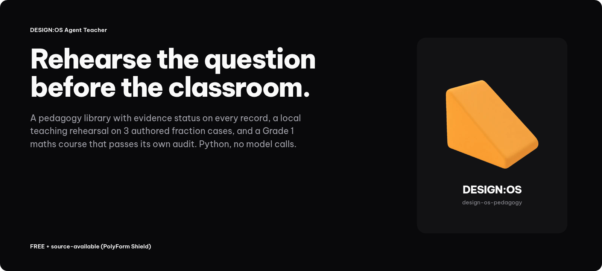
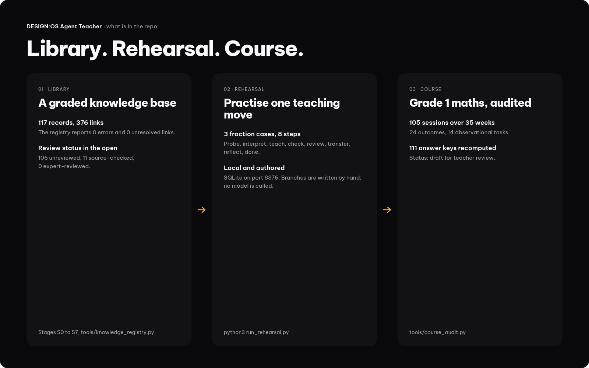
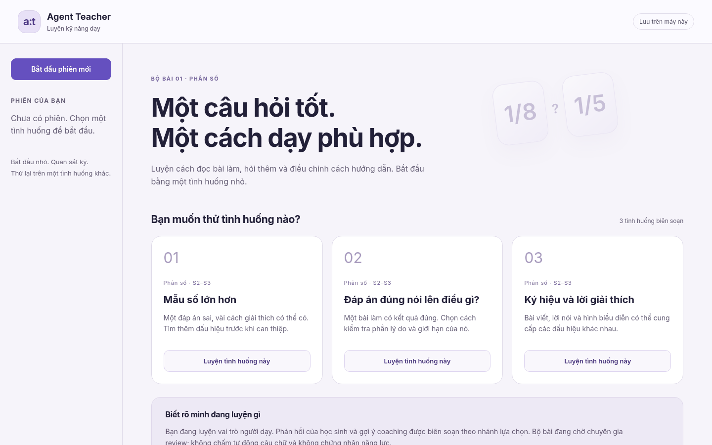
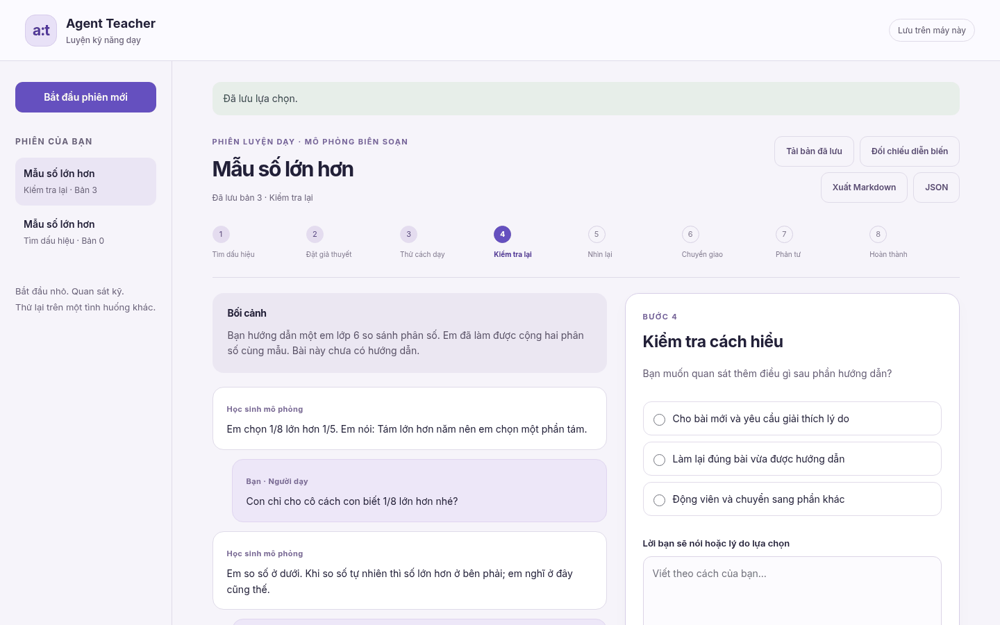

# DESIGN:OS Agent Teacher

<p>
<picture>
  <source media="(prefers-color-scheme: dark)" srcset="docs/images/readme/cover-dark.png">
  <source media="(prefers-color-scheme: light)" srcset="docs/images/readme/cover-light.png">
  
</picture>
</p>

Agent Teacher (`design-os-pedagogy`) is three things in one Python repository: a pedagogy knowledge library where every record carries its review status, a local app for rehearsing one teaching move on authored fraction cases, and a Grade 1 Vietnamese mathematics course that is checked by an executable audit. Nothing in it calls a language model.

It is early work. Of the 117 library records, 106 are still unreviewed, 11 are source-checked and none has had expert review. The rehearsal has 3 cases and has not been piloted with real teachers. Passing tests and a clean graph do not show that the teaching works.

FREE + source-available ([PolyForm Shield 1.0.0](LICENSE)). [Tiếng Việt](README.vi.md) · [Docs site](https://jangtrinh.github.io/design-os-pedagogy/)

<p>
  <a href="#quickstart">Quickstart</a> · <a href="#whats-in-the-repo">What's in the repo</a> · <a href="#the-rehearsal">Rehearsal</a> · <a href="#the-library">Library</a> · <a href="#the-grade-1-course">Course</a> · <a href="#checks">Checks</a> · <a href="#limits">Limits</a>
</p>

## Quickstart

The rehearsal app and `scripts/self_check.py` use only the Python standard library. The registry, coverage, course and publication tools need the two packages in `requirements.txt` (PyYAML and markdown-it-py). Python 3.10 or later.

```bash
git clone https://github.com/jangtrinh/design-os-pedagogy.git
cd design-os-pedagogy

# Open the rehearsal app (prints a local URL; --port 0 picks a free port, the default is 8876)
python3 run_rehearsal.py --port 0

# Tools that read the library and the course
python3 -m venv .venv && .venv/bin/pip install -r requirements.txt
.venv/bin/python -B tools/knowledge_registry.py
.venv/bin/python -B tools/knowledge_coverage.py --stage S2
.venv/bin/python -B tools/course_audit.py courses/vi-vn-grade-1-math
```

## What's in the repo

<p>
<picture>
  <source media="(prefers-color-scheme: dark)" srcset="docs/images/readme/flow-dark.png">
  <source media="(prefers-color-scheme: light)" srcset="docs/images/readme/flow-light.png">
  
</picture>
</p>

| Part | Where | State |
| :--- | :--- | :--- |
| Knowledge library | `00-system` to `90-agent-runtime`, mapped from [`00-navigation/MOC-Master.md`](00-navigation/MOC-Master.md) | 117 records, 376 links, registry errors 0. Mostly unreviewed |
| Rehearsal app | [`rehearsal/`](rehearsal/), [`run_rehearsal.py`](run_rehearsal.py) | Implemented. 3 Vietnamese fraction cases |
| Grade 1 course | [`courses/vi-vn-grade-1-math/`](courses/vi-vn-grade-1-math/) | Audit passes. Status `draft-for-teacher-review` |
| Publication pipeline | [`tools/pedagogy_pipeline.py`](tools/pedagogy_pipeline.py) | Implemented. Drafts stay `unreviewed` |
| Tutor runtime | [`90-agent-runtime/`](90-agent-runtime/) | Specification only. Not built |

## The rehearsal

You play the teacher. A simulated Grade 6 student gives an answer, and you choose what to do next and write what you would say. The app has 3 authored cases in [`rehearsal/data/fractions.vi.json`](rehearsal/data/fractions.vi.json): comparing fraction size, checking the reasoning behind a correct answer, and notation versus explanation. Each case runs through 8 steps: probe, interpret, teach, check, review, transfer, reflect, complete.

<p>

</p>

<sub>design:os by Jang</sub>

<p>

</p>

<sub>design:os by Jang</sub>

- The student lines and the coaching feedback follow authored branches. Your free text is saved but not graded.
- Sessions are stored in SQLite (`.data/rehearsal.sqlite3`, or a folder you pass with `--data-dir`). They keep revisions, handle duplicate submits, and can be reopened, replayed and exported as Markdown or JSON. The list shows the latest 100 sessions.
- Each session records the version and fingerprint of the case pack. If the pack changes, older sessions can still be read and exported but not continued.
- It is a local, single-user service, not a hosted multi-account system. It does not certify teaching skill.

The full behaviour is in [`docs/rehearsal-contract.md`](docs/rehearsal-contract.md).

## The library

Start at [`00-navigation/MOC-Master.md`](00-navigation/MOC-Master.md). Records are Markdown with YAML front matter.

| Area | What is there |
| :--- | :--- |
| `00-system` | Ontology, schemas, evidence policy and authoring contracts |
| `10-foundations`, `20-stages` | Foundations, and guidance by education stage S0 to S7 |
| `30-pedagogy`, `40-disciplines` | Methods, assessment and subject practice |
| `50-practice-library`, `60-evidence` | Cases, source records (30 of them), claims and estimates |
| `70-capabilities`, `80-professor-development` | Teaching capabilities CAP-01 to CAP-06, and professional development |
| `90-agent-runtime` | Runtime specification, prompts and evaluation proposals |

`tools/knowledge_registry.py` checks metadata, canonical IDs, explicit aliases and link types. Today it reports 117 records, 376 links, 0 errors, 0 unresolved links and 62 legacy warnings. `tools/knowledge_coverage.py` filters by stage, axis (AX-01 to AX-08) or capability, and reports review status without granting it.

New modules go through `tools/pedagogy_pipeline.py`: a `--dry-run` preview, an import with `--input`, then a separate `--apply`. Imports stay `unreviewed`, nothing is committed for you, and `--inspect-publication` and `--recover-publication` handle an interrupted apply. See [`docs/publication.md`](docs/publication.md).

## The Grade 1 course

[`courses/vi-vn-grade-1-math/`](courses/vi-vn-grade-1-math/) is a Grade 1 mathematics course written against the Vietnamese 2018 general education programme: 35 weeks, 3 periods a week, 105 sessions and 24 outcomes. `tools/course_audit.py` recomputes 111 answer keys, counts 14 observational tasks and checks strand coverage (number 84, geometry 16, experience 5 sessions). `tools/render_course.py` turns the audited data into teacher-facing Markdown. The course is a draft for teacher review and has not been taught. See [`docs/course-audit.md`](docs/course-audit.md).

## Checks

```bash
python3 scripts/self_check.py                    # required files and manifests are present
.venv/bin/python -B -m unittest discover -s tests # 98 tests
.venv/bin/python -B tools/knowledge_registry.py
.venv/bin/python -B tools/verify_links.py
```

Tests use their own temporary corpus and database. `verify_links.py` checks local paths and anchors only; it does not fetch external links or check that a source supports a claim. There is no CI workflow, so run these before you commit. [`docs/implementation-status.md`](docs/implementation-status.md) lists where the evidence for each part lives.

## Use it from an agent

The repo ships plugin manifests for Claude Code, Codex, Factory and `.agents`, plus a `/doctor` command:

```text
/plugin marketplace add jangtrinh/design-os-pedagogy
/plugin install design-os-pedagogy@design-os-pedagogy
```

The skill text in `skills/design-os-pedagogy/SKILL.md` still describes a broader tutoring runtime than the code implements. Trust this README and the code over it.

## Limits

- 106 of 117 records are unreviewed and none has expert review. Older grades or `validated` flags do not replace review.
- The rehearsal covers fractions only, in Vietnamese, with 3 cases. It has not been piloted with real teachers or learners; see [`docs/fraction-pilot.md`](docs/fraction-pilot.md).
- Free-text answers are stored, not assessed.
- The tutor runtime in `90-agent-runtime` is a specification.
- The publisher writes two files in sequence, not as one atomic transaction.

## DESIGN:OS

Agent Teacher is one of the DESIGN:OS tools. The others: [Studio](https://github.com/jangtrinh/design-os-studio), [CLI](https://github.com/jangtrinh/design-os), [Bridge](https://github.com/jangtrinh/design-os-figma-plugin), [SVG Animation](https://github.com/jangtrinh/design-os-svg-animation), [3D Blender](https://github.com/jangtrinh/design-os-3d-blender), [Knowledge Builder](https://github.com/jangtrinh/design-os-knowledge-builder) and [mcp-bridge-go](https://github.com/jangtrinh/mcp-bridge-go). More on [jangtrinh.github.io](https://jangtrinh.github.io/).

Changelog: [CHANGELOG.md](CHANGELOG.md) · Index for AI agents: [llms.txt](llms.txt) · Art direction: [ART-DIRECTION.md](ART-DIRECTION.md)

## Contributing and license

- [CONTRIBUTING.md](CONTRIBUTING.md) · [CODE_OF_CONDUCT.md](CODE_OF_CONDUCT.md) · [SECURITY.md](SECURITY.md) · [PRIVACY.md](PRIVACY.md)
- [PolyForm Shield 1.0.0](LICENSE). FREE to use and modify, including for paid client work; you may not resell it or build a competing product from it.

If `design-os-pedagogy` saves you time, a star on GitHub helps other engineers and AI agents find it.

<p align="left">
  <a href="https://buymeacoffee.com/jangtrinh">
    
  </a>
</p>

Built by [Jang Trịnh](https://github.com/jangtrinh), creative technologist and autonomous system architect. More projects and writing at [jang.work](https://www.jang.work/?utm_source=github&utm_medium=readme&utm_campaign=design-os-pedagogy).

[GitHub](https://github.com/jangtrinh) · [LinkedIn](https://www.linkedin.com/in/jangtrinh/) · [Hub](https://jangtrinh.github.io/) · [YouTube](https://www.youtube.com/@designosbyjang) · [X](https://x.com/Jangtrinhvn)
